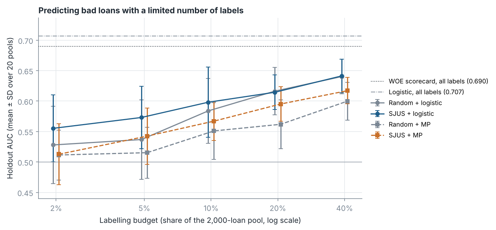

# Label-budget experiment

Generated by `run_label_budget.py`; the design is described in the docstring of that script. 20 pools of 2,000 development loans; every AUC is computed on the same holdout sample (2,958 loans, 155 bad).

References on the holdout sample: logistic regression on all 6,899 development loans with the same features, AUC 0.707; WOE scorecard of `run_scorecard.py`, AUC 0.690.

## Main results

Measure propagation (MP) here uses the symmetric nearest-neighbour graph and runs until the class distributions stop changing (median 227 iterations).

| budget | method | labelled | bads_labelled_mean | pools_without_bad | auc_mean | auc_sd | auc_min | auc_max |
|---|---|---|---|---|---|---|---|---|
| 2% | Random + logistic | 40 | 2.0 | 4 | 0.528 | 0.064 | 0.394 | 0.620 |
| 2% | SJUS + logistic | 40 | 1.4 | 4 | 0.555 | 0.055 | 0.475 | 0.648 |
| 2% | Random + MP | 40 | 2.0 | 4 | 0.511 | 0.041 | 0.438 | 0.610 |
| 2% | SJUS + MP | 40 | 1.4 | 4 | 0.513 | 0.050 | 0.448 | 0.649 |
| 5% | Random + logistic | 100 | 5.2 | 1 | 0.537 | 0.065 | 0.398 | 0.646 |
| 5% | SJUS + logistic | 100 | 3.8 | 2 | 0.573 | 0.051 | 0.491 | 0.668 |
| 5% | Random + MP | 100 | 5.2 | 1 | 0.515 | 0.042 | 0.456 | 0.600 |
| 5% | SJUS + MP | 100 | 3.8 | 2 | 0.542 | 0.046 | 0.481 | 0.630 |
| 10% | Random + logistic | 200 | 11.2 | 0 | 0.584 | 0.053 | 0.453 | 0.674 |
| 10% | SJUS + logistic | 200 | 8.2 | 0 | 0.598 | 0.058 | 0.398 | 0.684 |
| 10% | Random + MP | 200 | 11.2 | 0 | 0.551 | 0.047 | 0.432 | 0.621 |
| 10% | SJUS + MP | 200 | 8.2 | 0 | 0.567 | 0.032 | 0.503 | 0.618 |
| 20% | Random + logistic | 400 | 21.4 | 0 | 0.616 | 0.039 | 0.515 | 0.664 |
| 20% | SJUS + logistic | 400 | 17.6 | 0 | 0.615 | 0.028 | 0.545 | 0.671 |
| 20% | Random + MP | 400 | 21.4 | 0 | 0.562 | 0.040 | 0.490 | 0.631 |
| 20% | SJUS + MP | 400 | 17.6 | 0 | 0.595 | 0.028 | 0.530 | 0.628 |
| 40% | Random + logistic | 800 | 41.8 | 0 | 0.640 | 0.028 | 0.572 | 0.691 |
| 40% | SJUS + logistic | 800 | 38.1 | 0 | 0.641 | 0.028 | 0.588 | 0.688 |
| 40% | Random + MP | 800 | 41.8 | 0 | 0.600 | 0.031 | 0.539 | 0.649 |
| 40% | SJUS + MP | 800 | 38.1 | 0 | 0.617 | 0.022 | 0.567 | 0.651 |

`bads_labelled_mean`: average number of bad loans in the labelled set. `pools_without_bad`: pools in which the labelled set contained no bad loan; the AUC of those runs is 0.5.

## Paired differences

Differences in holdout AUC between two methods on the same pool and budget, with a 95% t-interval over the 20 pools. The pools overlap and share one holdout sample, so the differences are not independent and the intervals are likely too narrow; they indicate the size and consistency of a difference rather than a formal test.

| comparison | budget | mean_difference | ci_low | ci_high | pools_positive |
|---|---|---|---|---|---|
| SJUS - Random, logistic | 2% | +0.027 | -0.012 | +0.067 | 11 of 20 |
| SJUS - Random, logistic | 5% | +0.036 | -0.004 | +0.076 | 14 of 20 |
| SJUS - Random, logistic | 10% | +0.014 | -0.021 | +0.050 | 11 of 20 |
| SJUS - Random, logistic | 20% | -0.002 | -0.025 | +0.021 | 7 of 20 |
| SJUS - Random, logistic | 40% | +0.001 | -0.017 | +0.019 | 10 of 20 |
| SJUS - Random, MP | 2% | +0.001 | -0.030 | +0.033 | 10 of 20 |
| SJUS - Random, MP | 5% | +0.027 | -0.002 | +0.056 | 15 of 20 |
| SJUS - Random, MP | 10% | +0.016 | -0.012 | +0.045 | 10 of 20 |
| SJUS - Random, MP | 20% | +0.033 | +0.012 | +0.054 | 14 of 20 |
| SJUS - Random, MP | 40% | +0.017 | +0.006 | +0.029 | 14 of 20 |
| MP - logistic, random selection | 2% | -0.017 | -0.047 | +0.014 | 7 of 20 |
| MP - logistic, random selection | 5% | -0.022 | -0.044 | +0.000 | 7 of 20 |
| MP - logistic, random selection | 10% | -0.033 | -0.057 | -0.008 | 7 of 20 |
| MP - logistic, random selection | 20% | -0.054 | -0.079 | -0.030 | 2 of 20 |
| MP - logistic, random selection | 40% | -0.040 | -0.053 | -0.028 | 0 of 20 |
| MP - logistic, SJUS selection | 2% | -0.043 | -0.069 | -0.016 | 3 of 20 |
| MP - logistic, SJUS selection | 5% | -0.031 | -0.054 | -0.007 | 4 of 20 |
| MP - logistic, SJUS selection | 10% | -0.031 | -0.057 | -0.005 | 4 of 20 |
| MP - logistic, SJUS selection | 20% | -0.019 | -0.034 | -0.005 | 5 of 20 |
| MP - logistic, SJUS selection | 40% | -0.024 | -0.035 | -0.013 | 3 of 20 |
| SJUS - Random, MP (ADGSSL code) | 2% | -0.007 | -0.023 | +0.009 | 8 of 20 |
| SJUS - Random, MP (ADGSSL code) | 5% | +0.000 | -0.015 | +0.015 | 9 of 20 |
| SJUS - Random, MP (ADGSSL code) | 10% | +0.019 | -0.003 | +0.040 | 13 of 20 |
| SJUS - Random, MP (ADGSSL code) | 20% | +0.017 | +0.003 | +0.032 | 15 of 20 |
| SJUS - Random, MP (ADGSSL code) | 40% | +0.000 | -0.023 | +0.024 | 9 of 20 |

## Sensitivity: measure propagation as in the ADGSSL code

Directed nearest-neighbour graph and the original stopping rule (stop when the relative decrease of the convergence measure is at most 0.1). With SJUS selection this rule stopped after 2 iterations in the median run (94 of 94 runs stopped after at most 2 iterations).

| budget | method | labelled | bads_labelled_mean | pools_without_bad | auc_mean | auc_sd | auc_min | auc_max | mp_iterations_median |
|---|---|---|---|---|---|---|---|---|---|
| 2% | Random + MP (ADGSSL code) | 40 | 2.0 | 4 | 0.507 | 0.028 | 0.462 | 0.577 | 2 |
| 2% | SJUS + MP (ADGSSL code) | 40 | 1.4 | 4 | 0.500 | 0.020 | 0.473 | 0.558 | 2 |
| 5% | Random + MP (ADGSSL code) | 100 | 5.2 | 1 | 0.503 | 0.022 | 0.468 | 0.538 | 2 |
| 5% | SJUS + MP (ADGSSL code) | 100 | 3.8 | 2 | 0.503 | 0.024 | 0.457 | 0.565 | 2 |
| 10% | Random + MP (ADGSSL code) | 200 | 11.2 | 0 | 0.501 | 0.031 | 0.455 | 0.573 | 2 |
| 10% | SJUS + MP (ADGSSL code) | 200 | 8.2 | 0 | 0.520 | 0.026 | 0.476 | 0.575 | 2 |
| 20% | Random + MP (ADGSSL code) | 400 | 21.4 | 0 | 0.508 | 0.035 | 0.451 | 0.570 | 18 |
| 20% | SJUS + MP (ADGSSL code) | 400 | 17.6 | 0 | 0.525 | 0.026 | 0.481 | 0.583 | 2 |
| 40% | Random + MP (ADGSSL code) | 800 | 41.8 | 0 | 0.536 | 0.046 | 0.462 | 0.612 | 29 |
| 40% | SJUS + MP (ADGSSL code) | 800 | 38.1 | 0 | 0.536 | 0.023 | 0.489 | 0.581 | 2 |

## Outcome similarity of neighbouring loans

On the development sample, among the 5 nearest neighbours of each loan (standardised features), the share of bad loans is 6.7% for bad loans and 4.8% for good loans (overall bad rate 5.25%).
