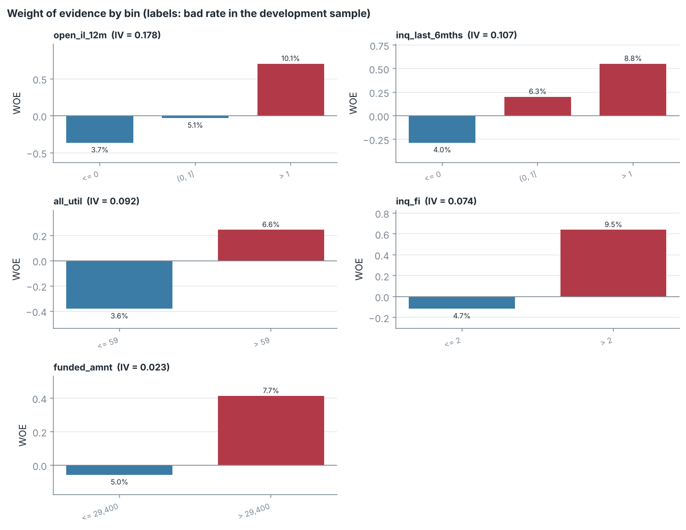
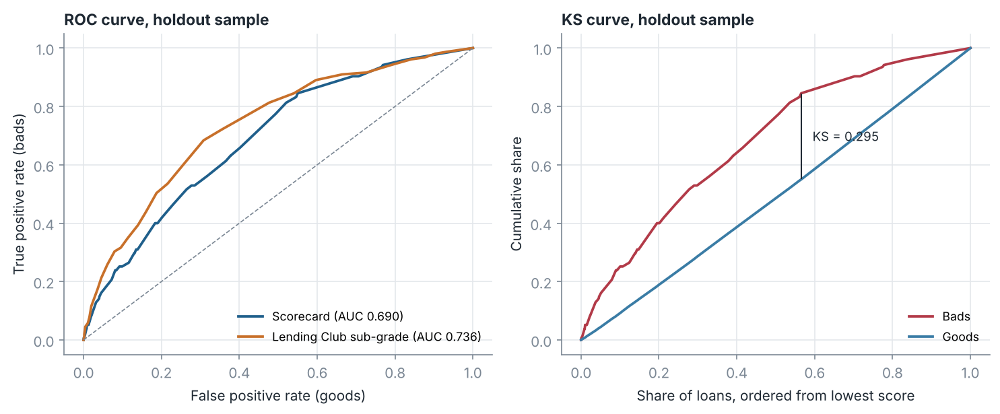
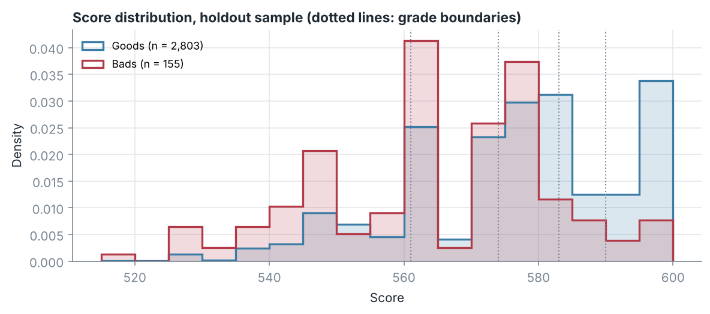
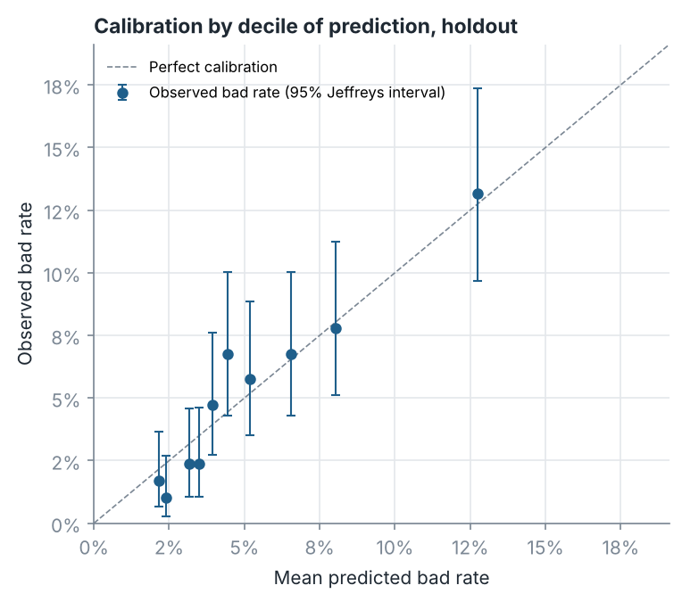

# Validation report: Lending Club application scorecard

Generated by `run_scorecard.py`. All results refer to one stratified random split (seed 2026). The bootstrap intervals describe the sampling variation of the holdout estimates for the fitted model; they do not include the variation that re-fitting on a different split would add.

## 1. Data and outcome

- Source: Lending Club loans issued in the first quarter of 2016, as distributed in the R package `modeldata` (`lending_club`). 9,857 loans, 517 bad (5.25%).
- Outcome: a loan is **bad** if it was charged off, in default or 21-120 days late when the data were extracted, and good otherwise. The extraction date is not given, so the outcome has no fixed performance window and is not a 12-month default flag. The model therefore estimates the probability of this bad flag, referred to below as the predicted bad rate.
- Split: stratified random split into a development sample (6,899 loans, 362 bad) and a holdout sample (2,958 loans, 155 bad). Binning, variable selection and estimation use the development sample only.
- Variables kept out of the candidate set:
  - `sub_grade`: the lender's own risk grade; used as the benchmark.
  - `int_rate`: priced from the lender's risk grade.
  - `verification_status`: whether income was verified was decided by the lender, so the variable may partly reflect the lender's own assessment; verified income has the higher bad rate, which would give fewer points to applicants whose income was checked.
  - `addr_state`: geographic variable; excluded to reduce the risk of proxies for protected characteristics (no fair-lending analysis of the remaining variables was carried out).
- The extract has no application dates, so no out-of-time sample can be formed. The holdout comes from the same quarter as the development sample.

## 2. Variable screening and selection

18 candidate variables were binned with monotonic coarse classes: at least 5% of the development sample per class, at most 6 classes, and adjacent classes merged while the chi-square statistic comparing their bad rates is below 3.84. Selection then used an information value of at least 0.02, a maximum absolute correlation of 0.6 between WOE-transformed variables (the variable with the higher IV is kept), and backward elimination of variables with a wrong-signed coefficient or a Wald p-value above 0.05. A variable dropped by the correlation filter was offered again if the variable that blocked it was later eliminated.

Candidate merging thresholds were compared by 3 repetitions of 5-fold cross-validation of the whole procedure (binning, selection and fit) on the development sample, with the rule of keeping the largest threshold whose mean AUC is within one standard error of the best:

| min_chi2 | cv_auc_mean | cv_auc_sd | cv_auc_se |
|---|---|---|---|
| 0.00 | 0.6373 | 0.0280 | 0.0072 |
| 1.00 | 0.6435 | 0.0255 | 0.0066 |
| 2.71 | 0.6415 | 0.0306 | 0.0079 |
| 3.84 | 0.6422 | 0.0276 | 0.0071 |

The cross-validation did not distinguish between the thresholds: all mean AUCs lie within one standard error of the best, so the rule selected the most parsimonious value in the grid (3.84). The standard errors treat the 15 folds as independent and are therefore too small.

| variable | description | bins | iv | selected |
|---|---|---|---|---|
| open_il_12m | Instalment accounts opened in the past 12 months | 3 | 0.1785 | yes |
| open_il_24m | Instalment accounts opened in the past 24 months | 3 | 0.1504 |  |
| inq_last_6mths | Credit inquiries in the past 6 months | 3 | 0.1066 | yes |
| all_util | Balance to credit limit on all trades (%) | 2 | 0.0921 | yes |
| inq_last_12m | Credit inquiries in the past 12 months | 3 | 0.0881 |  |
| inq_fi | Personal finance inquiries | 2 | 0.0743 | yes |
| total_bal_il | Total current balance of instalment accounts | 2 | 0.0499 |  |
| open_il_6m | Currently active instalment trades | 2 | 0.0301 |  |
| term | Loan term (36 or 60 months) | 2 | 0.0239 |  |
| funded_amnt | Loan amount funded | 2 | 0.0234 | yes |
| total_il_high_credit_limit | Total high credit / credit limit of instalment accounts | 2 | 0.0204 |  |
| emp_length | Employment length in years (10 = 10 or more; missing if not reported) | 3 | 0.0198 |  |
| num_il_tl | Number of instalment accounts | 2 | 0.0125 |  |
| revol_util | Revolving line utilisation (%) | 2 | 0.0114 |  |
| annual_inc | Self-reported annual income | 1 | 0.0000 |  |
| delinq_2yrs | Delinquencies (30+ days) in the past 2 years | 1 | 0.0000 |  |
| acc_now_delinq | Accounts on which the borrower is now delinquent | 1 | 0.0000 |  |
| delinq_amnt | Past-due amount owed on delinquent accounts | 1 | 0.0000 |  |

Steps after the IV filter:

| step | variable | reason |
|---|---|---|
| Correlation filter | open_il_24m | correlation 0.66 with open_il_12m (higher IV) |
| Correlation filter | total_il_high_credit_limit | correlation 0.83 with total_bal_il (higher IV) |
| Backward elimination | open_il_6m | coefficient -0.518 has the wrong sign |
| Backward elimination | inq_last_12m | p = 0.638 > 0.05 |
| Backward elimination | total_bal_il | p = 0.386 > 0.05 |
| Backward elimination | term | p = 0.058 > 0.05 |
| Re-entry | total_il_high_credit_limit | no remaining variable has a correlation above the limit |
| Backward elimination | total_il_high_credit_limit | p = 0.963 > 0.05 |

## 3. Model and scorecard

Logistic regression of the bad flag on the WOE of the 5 selected variables. With WOE = ln(%bad/%good), all coefficients are expected to be positive.

| variable | coef | std_err | z | p_value | iv | vif |
|---|---|---|---|---|---|---|
| (Intercept) | -2.892 | 0.056 | -51.42 | <0.001 |  |  |
| open_il_12m | 0.748 | 0.128 | 5.85 | <0.001 | 0.178 | 1.09 |
| inq_last_6mths | 0.815 | 0.165 | 4.93 | <0.001 | 0.107 | 1.03 |
| all_util | 0.774 | 0.190 | 4.07 | <0.001 | 0.092 | 1.04 |
| inq_fi | 0.503 | 0.189 | 2.66 | 0.008 | 0.074 | 1.06 |
| funded_amnt | 0.916 | 0.333 | 2.75 | 0.006 | 0.023 | 1.00 |

Scaling: 600 points at good:bad odds of 50:1, 20 points to double the odds. Attribute points are rounded to integers, and the base points are shifted by the mean rounding error of the attribute points before they are rounded themselves. After rounding, the mean development score differs from the unrounded score by -0.06 points, and the mean predicted bad rate on the development sample is 5.27% (unrounded 5.25%; observed 5.25%). The points table is in `tables/scorecard_points.csv`.

## 4. Discrimination

| sample | loans | bads | AUC | AUC 95% CI | Gini | KS | KS 95% CI |
|---|---|---|---|---|---|---|---|
| Development | 6899 | 362 | 0.673 | 0.647-0.702 | 0.346 | 0.264 | 0.224-0.310 |
| Holdout | 2958 | 155 | 0.690 | 0.645-0.730 | 0.380 | 0.295 | 0.238-0.360 |

Intervals: percentile bootstrap, 1000 resamples stratified by outcome.

The holdout AUC (0.690) is higher than both the development AUC (0.673) and the cross-validated AUC of the whole procedure on the development sample (0.642, Section 2). This split therefore appears favourable to the model, and the cross-validated value is the more cautious estimate of discrimination on new loans of the same kind.

Benchmark on the holdout sample: Lending Club's sub-grade (A1 to G5, used as an ordinal ranking) has an AUC of 0.736. The difference scorecard minus sub-grade is -0.047 (95% bootstrap interval -0.092 to -0.002). The sub-grade was assigned by the lender using information that is not in this extract, so it is a reference point rather than a like-for-like competitor.

Challenger: L2-regularised logistic regression (C = 1) on all 19 standardised candidate features without binning (amounts log-transformed; employment length imputed with the median plus a missing indicator). Holdout AUC 0.707; scorecard minus challenger -0.017 (95% bootstrap interval -0.050 to +0.014). The scorecard uses 5 variables with 2 to 3 classes each.

## 5. Calibration on the holdout sample

The tests below are the binomial and Jeffreys tests used in PD backtesting, applied to the bad flag defined in Section 1. Because the holdout is a random sample from the same quarter and the outcome has no fixed horizon, they check calibration on comparable loans; they are not a backtest of a 12-month PD.

- Overall: mean predicted bad rate 5.21% against an observed bad rate of 5.24% (two-sided exact binomial test, p = 0.934).
- Hosmer-Lemeshow statistic over 10 groups of the predicted bad rate: 8.96, p = 0.536 (10 degrees of freedom, the reference distribution for an independent validation sample).
- Brier score 0.0484; a constant prediction equal to the development bad rate gives 0.0497.
- Highest decile: predicted 12.75%, observed 13.18%.

Rating grades: 5 grades cut at the quintiles of the development score (A = lowest risk). For each grade the observed bad rate on the holdout sample is compared with the mean prediction for the same loans. `p_too_low` and `p_too_high` are the two one-sided Jeffreys tests; `p_binomial_too_low` is the one-sided exact binomial test.

| grade | score_range | n | bads | observed_bad_rate | mean_predicted | jeffreys_low | jeffreys_high | p_too_low | p_too_high | p_binomial_too_low |
|---|---|---|---|---|---|---|---|---|---|---|
| A | >= 590 | 657 | 9 | 1.37% | 2.33% | 0.68% | 2.49% | 0.957 | 0.043 | 0.969 |
| B | >= 583 and < 590 | 628 | 15 | 2.39% | 3.41% | 1.40% | 3.81% | 0.926 | 0.074 | 0.942 |
| C | >= 574 and < 583 | 514 | 33 | 6.42% | 4.36% | 4.54% | 8.79% | 0.015 | 0.985 | 0.019 |
| D | >= 561 and < 574 | 582 | 36 | 6.19% | 5.94% | 4.44% | 8.36% | 0.391 | 0.609 | 0.425 |
| E | < 561 | 577 | 62 | 10.75% | 10.47% | 8.42% | 13.47% | 0.407 | 0.593 | 0.433 |

Grades with prediction too low at the 5% level: C; prediction too high at the 5% level: A. Observed bad rates go from 1.37% in grade A to 10.75% in grade E; they are not in increasing order for grades C (6.42%) and D (6.19%).

The same deviations appear in the development sample (grade C: observed 5.44%, predicted 4.35%; grade A: observed 1.69%, predicted 2.32%; table in `tables/grade_backtest_development.csv`). Ten one-sided tests would produce about 0.5 rejections at the 5% level by chance, but a deviation repeated in both samples points to a lack of fit of the additive model in these score ranges. A common remedy is to assign each grade the bad rate observed for it in the development sample (a master scale) and to test those grade-level rates on new data.

## 6. Stability

Population stability index of the score, development against holdout, over 9 bins cut at the deciles of the development score (fewer than 10 because of tied scores): 0.0015 (stable). Characteristic stability index (CSI) of each model variable over its bins:

| variable | csi | assessment |
|---|---|---|
| open_il_12m | 0.0001 | stable |
| inq_last_6mths | 0.0005 | stable |
| all_util | 0.0000 | stable |
| inq_fi | 0.0008 | stable |
| funded_amnt | 0.0002 | stable |

Thresholds: below 0.10 stable, 0.10-0.25 moderate shift, above 0.25 significant shift. Both samples are random draws from the same quarter, so these values measure sampling variation only and say nothing about stability over time. In production, the same calculation would be run on each new application cohort.

## 7. Limitations

- One quarter of originations and a single random split; no out-of-time test.
- The outcome was recorded at an unspecified date after origination, so loans of different ages are pooled and some loans labelled good may still go bad.
- Only funded applications are observed; no reject inference is attempted.
- 517 bads in total; grade-level results rest on few bads.
- The extract contains a subset of the variables available at application, which also limits the comparison with the lender's sub-grade.
- Excluding `addr_state` does not remove the possibility that other variables act as proxies for protected characteristics; no fair-lending analysis was carried out.
